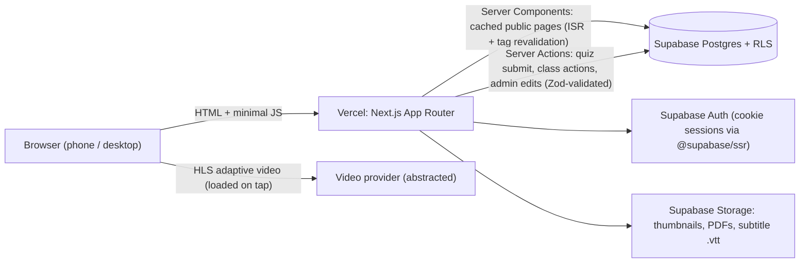
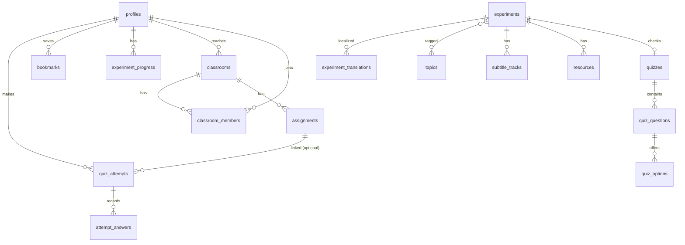

# Chemistry Learning Platform: Phase 0 Plan (Project A, Antigravity)

> [!IMPORTANT]
> **Status: planning only.** I have not created or modified any project files, run any setup commands, installed packages, or written code. The workspace `chemistry-learning-platform-claude` is still empty. I will start only after you explicitly approve this plan, or a revised version of it.

---

## 1. Understanding and scope check

### 1.1 What the platform is
It is a **public-first, mobile-first, video-led chemistry experiment library**. A small curated collection of **about 20–30 experiment videos** comes with objectives, materials, safety guidance, scientific explanations, and **multiple-choice knowledge checks**. Optional accounts add **student progress tracking**, **teacher classrooms with assignments**, and an **admin content interface**.

**Why it exists:** Chemistry teaching in Kyrgyzstan is seen as not practical enough. Experiments recorded in UCA laboratories (according to the programme as you understand it) would let teachers and students *see* real chemistry even when their school lab cannot run it.

**What it is for us:** This is an **independent internship portfolio demonstration** to support your application for one of the two CS internship places. It is not an official UCA, U.S. Embassy, or Ministry website, and it must never suggest that it is.

### 1.2 Firm constraints (I confirm these)
- ✅ **20–30 experiment videos maximum.** The library is a simple gallery, not a course catalogue.
- ✅ **No grades and no weeks** anywhere in the library or on experiment pages. That means no grade or week filters, badges, paths, units, semesters, or schedules. The only dates in the product are deadlines that a teacher sets on a classroom assignment.
- ✅ Anyone can watch without signing in. Accounts are optional for students and teachers. Admin access is protected on the server.
- ✅ Stack: **Next.js App Router + React + TypeScript + Tailwind CSS + shadcn/ui + Supabase (Postgres + Auth)**, deployed on **Vercel**. No WordPress.
- ✅ This is a separate codebase, Supabase project, Git repo, and deployment from the later Codex project (Project B).

### 1.3 Facts vs. decisions vs. proposals vs. open items

| Category | Items |
|---|---|
| **Facts (from the supplied documents)** | UCA SPCE and the U.S. Embassy Bishkek STEM programme for 29 chemistry teachers. Two CS interns, Feb–mid-Apr 2027. The ToR describes an MVP inspired by experimentium.org. Handover to the education ministry is described but not verified. Who owns or operates the final site is **unknown**. |
| **Your confirmed decisions** | Public browsing without login. Student, teacher, and admin roles. MCQ quizzes with scores, explanations, and progress. Teacher classrooms with assignments and monitoring. 20–30 videos. No grades or weeks. The agreed stack. Plan before code. |
| **Proposed (needs your approval)** | Everything in this plan marked *proposed*: name, palette, fonts, topic list, the "safety level" filter, video provider, anonymous practice quizzes, quiz retake rules, enrollment policy, progress definitions. |
| **Open / not settled** | See §9. The final name and brand, real videos and approved chemistry text, the final list of experiments, the media provider, the language default, the policy for minors, and production hosting. |

---

## 2. Product and UX plan

### 2.1 Proposed sitemap
All public routes have a locale prefix (`/ky`, `/ru`, and optionally `/en`).

```
PUBLIC (no login)
/                      Home
/experiments           Experiment library (gallery + search + topic filter)
/experiments/[slug]    Experiment learning page (video, guide, quiz)
/teachers              For teachers: what classrooms offer, how to start
/about                 About the project + "How it works" + demo disclaimer
/safety                General lab-safety principles & "watch vs. do" guidance
/legal/privacy, /legal/terms, /accessibility

AUTH
/sign-in  /sign-up (choose Student or Teacher)  /forgot-password  /auth/callback

STUDENT (signed in)
/me                    Dashboard: continue watching, assignments due, progress
/me/saved              Saved experiments
/me/history            Quiz attempts & scores
/me/classes            Joined classes  ·  /join (enter class code)

TEACHER (signed in, role=teacher)
/teach                 Dashboard: my classes, recent submissions
/teach/classes/new
/teach/classes/[id]            Overview (roster, assignments, completion)
/teach/classes/[id]/assign     Pick experiment + quiz + optional deadline
/teach/classes/[id]/students/[studentId]   Individual results (own class only)

ADMIN (role=admin)
/admin                 Content overview + translation status
/admin/experiments, /admin/experiments/[id] (tabs: Details · Content per language · Video & subtitles · Resources · Quiz · Publish)
/admin/topics, /admin/quizzes, /admin/users (role management)
```

### 2.2 Homepage content hierarchy (text wireframe, mobile first)
```
┌ Header: Logo · [Experiments] · ☰ menu · Language (КЫР/РУС) ┐
│ HERO: "See chemistry happen." + 1-line purpose              │
│   [Explore experiments]  [For teachers →]                   │
│   Visual: looping-free still of a reaction (poster image)   │
├ Featured experiments: 3–6 cards (horizontal scroll on mobile)
├ How it works: 1 Watch → 2 Understand → 3 Check yourself     │
├ Browse by topic: 6–8 topic chips with icon + count           │
├ Two paths: [Students: learn at your pace] [Teachers: classes]│
├ Safety first: "Observe, understand, then practise only with  │
│   a teacher in a proper lab." → /safety                      │
├ Works on any phone / low data: brief reassurance strip       │
└ Footer: About · Safety · Privacy · Accessibility · Language  │
   "Independent portfolio demonstration — not an official      │
    website of UCA, the U.S. Embassy, or any government body." ┘
```

### 2.3 Experiment library (no grades, no weeks)
- **Layout:** A responsive card grid with 1 column on small phones, 2 on large phones and tablets, and 3–4 on desktop. For 20–30 items I recommend **no pagination**: show everything, and search and filters narrow the list instantly.
- **Card:** 16:9 thumbnail, a duration badge, title, a two-line description, topic chip(s), a safety-level icon, and a "Demo content" ribbon while placeholders are in use. Saving with the bookmark icon is available to signed-in users.
- **Controls:** A keyword search box that matches title, description, topic, and keywords, and also tolerates searching in the other language. Below it are topic chips (single or multi-select) and a sort menu (*Recommended order · A–Z · Shortest first*). Filter state lives in the URL (`?topic=gases&q=…`), so links can be shared.
- **Optional, proposed filter: safety level.** Values are *Observe only · Teacher demonstration · Supervised student lab*. This is not grade-based and it supports the safety message. You decide whether to include it.
- **States:** A skeleton grid while loading; "No experiments match 'xyz'" with a *Clear filters* action; an error card with *Retry*.

### 2.4 Experiment learning page (the most important page)
```
MOBILE (single column)                 DESKTOP (2 columns, sticky side)
─────────────────────────              ──────────────────────────────────────
Breadcrumb: Experiments / Gases        [ Video player 16:9               ] [Sidebar:      ]
[ VIDEO (poster → loads on tap) ]      Title · topic · duration · safety     Materials     ]
Title, topic chips, duration           Tabs/anchors: Overview · Safety ·     Safety level  ]
⚠ Safety callout (always visible)        Procedure · Explanation · Quiz      Downloads     ]
Section nav (sticky chips):                                                  [Assign to   ]
 Overview | Safety | How | Why | Quiz                                        [ class] (tch)]
1. Overview + "You will learn to…"
2. Materials & equipment
3. Safety guidance (icons + text, expert-approved flag)
4. What happens: step summary with video timestamps (tap = seek)
5. The chemistry: explanation + equation (rendered with KaTeX/mhchem)
6. Transcript & downloads (PDF handout, subtitles)
7. Check your understanding: 5-question MCQ
8. Related experiments (same topic)
```
- **Video timestamps are linked to the steps**, so tapping "Step 3" jumps the video to that point. This is a strong interactive feature that costs little bandwidth.
- **Quiz UX:** Questions are shown one at a time on mobile, with a progress bar. After submitting, the learner sees the score, a correct or incorrect state on every option, an **explanation for each question**, and options to *Retry* or *Rewatch the relevant moment*.
- **Teachers** get an *Assign to class* button. **Anonymous users** see a gentle "Sign in to save your score" prompt after finishing a quiz, never before.

### 2.5 Student, teacher, and admin UX
- **Student dashboard:** Three blocks: *Assignments due* (with the nearest deadline first), *Continue learning* (recently viewed), and *Progress* (for example "12 of 24 experiments explored" and the average quiz score). No leaderboards, rankings, or public comparison between students.
- **Teacher dashboard:** A card per class showing student count, active assignments, and completion %. The class view is a simple table: rows are students, columns are assignments, and each cell shows ✓, the score, or "not started". Teachers can click into an individual student's view. There is a copyable **join code** and a share link, and teachers can regenerate the code or turn joining off.
- **Admin:** A table of experiments with a status (Draft/Published) and **translation completeness badges per language**. The editor uses tabs. Each language has fields labelled *Missing / Draft / Needs expert review / Approved*. The quiz builder is inline. Publishing invalidates the cached public pages, so changes appear without a redeploy.

### 2.6 Navigation and mobile
- **Public pages:** A compact sticky header with the logo, a permanently visible **Experiments** link, a language switch, and a menu sheet for everything else. Sign in sits in the header on desktop and in the menu sheet on mobile.
- **Signed-in areas:** On mobile, a **bottom tab bar** (*Home · Experiments · Classes · Me*) gives thumb-friendly navigation. On desktop, a left sidebar. Both areas use the same visual system, so they feel like one product.
- Tap targets are at least 44 px, there is no hover-only UI, and body text is at least 16 px.

### 2.7 Language treatment (proposed)
- I propose **Kyrgyz and Russian as equal first-class languages** and English as optional. The default comes from the browser's language and is remembered in a cookie. If the browser preference can't be used, the site falls back to Kyrgyz. **This needs your decision.**
- UI strings live in message files (`ky.json`, `ru.json`, `en.json`) managed by `next-intl`. **Content** (experiments, quizzes, subtitles) is translated in the database with a per-field review status.
- Any sample translation I write is marked **"Unverified sample translation, needs expert review"**. I will never present one as approved scientific text.
- Fonts are tested against the Kyrgyz-specific letters **Ң ң Ө ө Ү ү** before they are adopted.

---

## 3. MVP feature matrix

| Priority | Feature |
|---|---|
| **Must (end-to-end showcase)** | Bilingual public shell · Homepage · Gallery with search and topic filter · Experiment page (video, captions, objectives, materials, safety, steps, explanation, related) · 5-question MCQ quiz with server-side scoring and explanations · Supabase Auth (email + password) · Student attempts, progress, dashboard · Teacher classrooms, join code, assign experiment and quiz with deadline, class results table · Admin CRUD for experiments, translations, quizzes, and publish state · RLS on every table · Demo disclaimer · Responsive and accessible core flows · Vercel deployment with fictional seed data |
| **Should** | Anonymous practice quizzes (not saved) · Bookmarks · Step timestamps linked to the video · Downloadable handouts (PDF) · Transcript · Safety-level filter · Teacher removes a student or regenerates the join code · Admin role management UI · "Data saver" mode · Minimal audit log of admin actions |
| **Could (later)** | Join requests that need teacher approval · Teacher-authored custom quizzes · CSV export of class results · Content revision history · PWA and offline viewing of text content · Option shuffling · English UI |
| **Later enhancements (not in MVP)** | Interactive simulations · Recommendations · Advanced analytics · Moderated teacher resource sharing · Any AI features |

---

## 4. Architecture proposal

### 4.1 Overview


- **Public pages are statically generated and cached.** When an admin publishes, `revalidateTag('experiments')` refreshes them. The result is very fast pages on slow networks and almost no database load from anonymous visitors.
- **Writes go through Server Actions.** Every action validates input with **Zod**, re-checks the session and role on the server, and relies on **RLS as a second line of defence**.
- **No extra backend.** No Express, no microservices. The **service-role key** is used only in server-only modules for rare admin tasks, and it never reaches browser code.

### 4.2 Video hosting: proposal (not decided)

| Option | Pros | Cons | Fit |
|---|---|---|---|
| **Bunny Stream** | Adaptive HLS, low cost, global CDN, simple API, no ads | Small paid account required | ⭐ Recommended for a realistic demo and for production |
| **Cloudflare Stream** | Reliable, priced per minute, simple embeds | Costs grow with minutes watched | Strong alternative |
| **Mux** | Excellent developer experience and analytics | Can get expensive at national scale | Good for the demo, weaker for cost at scale |
| **YouTube (unlisted, nocookie)** | Free, adaptive, familiar | Ads and recommendations, tracking, less control, brand dilution | Acceptable fallback for the demo only |
| **Supabase Storage MP4** | Already in the stack | No adaptive bitrate, bandwidth costs | Not recommended for video |

**My recommendation:** Build a provider-agnostic `VideoSource` interface (`{ provider, playbackId/url, poster, tracks[] }`) and one player component (native `<video>` plus a lazily loaded `hls.js`, or Vidstack). The demo can start with a few clearly licensed placeholder clips (for example CC-licensed Wikimedia Commons footage, with attribution). We switch to Bunny or Cloudflare when real footage exists. **Prices must be checked at decision time.** I won't sign up for anything without your approval.

### 4.3 Proposed folder organization (feature-based)
```
src/
  app/[locale]/
    (public)/  page.tsx · experiments/ · experiments/[slug]/ · teachers/ · about/ · safety/ · legal/
    (auth)/    sign-in/ · sign-up/ · forgot-password/
    (student)/ me/ · join/
    (teacher)/ teach/ ...
    admin/     ...
    layout.tsx  (fonts, providers, header/footer)
  features/
    experiments/  components/ · queries.ts · types.ts
    quiz/         components/ · actions.ts · schemas.ts
    classrooms/   components/ · actions.ts · queries.ts · schemas.ts
    progress/  ·  admin/  ·  auth/
  components/
    ui/          (shadcn primitives, restyled with our tokens)
    layout/      (Header, Footer, MobileTabBar, LanguageSwitch, DemoBadge)
    video/       (VideoPlayer, CaptionMenu, provider adapters)
  lib/ supabase/{server,browser,middleware}.ts · i18n/ · auth/guards.ts · utils.ts
  messages/ ky.json · ru.json · en.json
supabase/ migrations/*.sql · seed.sql · tests/ (RLS tests)
tests/ unit/ · e2e/ (Playwright)
docs/ PROJECT_SPEC.md · DECISIONS.md (ADR log) · DATA_MODEL.md · DEPLOY.md · HANDOVER.md
```

### 4.4 Supporting libraries (proposed, minimal)
`next-intl` (i18n), `@supabase/ssr`, `zod`, `react-hook-form`, `katex` + `mhchem` (equations rendered on the server, no client JavaScript), `hls.js` (lazy-loaded), `lucide-react` (icons). For tooling: Vitest + Testing Library, Playwright + `@axe-core/playwright`, ESLint, Prettier, Husky + lint-staged. I will confirm the latest stable versions when setup is approved.

---

## 5. Data and security plan

### 5.1 Candidate schema (for review; not final)

Key fields:
- `profiles`: `role` enum (student, teacher, admin), display_name, preferred_locale.
- `experiments`: slug, status (draft or published), sort_order, duration, safety_level, video provider and playback id, poster.
- Translations, questions, and options each use per-locale text with a `review_status`.
- `quiz_options.is_correct` and the explanations are **never readable directly by the client** before an answer is submitted.
- `assignments`: classroom_id, experiment_id, quiz_id, due_at.
- `classrooms.join_code`: a unique code of 6–8 characters from an alphabet with no look-alike characters.

### 5.2 Role and access model (RLS summary)

| Data | Anonymous | Student | Teacher | Admin |
|---|---|---|---|---|
| Published experiments, topics, resources | read | read | read | full |
| Draft content | ✗ | ✗ | ✗ | full |
| Quiz questions and options (without answers) | read | read | read | full |
| Correct answers and explanations | only via the grading function, after submitting | same | same | full |
| Own attempts, progress, bookmarks | ✗ | own only | own only | read |
| Classrooms | ✗ | classes they belong to (name, assignments) | **own classes only** | full |
| Classmates' results | ✗ | **never** | own students, within own classes | full |
| `profiles.role` | ✗ | cannot change | cannot change | change via admin UI |

### 5.3 Security rules I will follow
- **Secure scoring:** A `SECURITY DEFINER` Postgres function `grade_quiz(quiz_id, answers)` does the work. It scores on the server, returns the per-question correctness and explanations, and stores the attempt **only** when a user is signed in. The browser never receives the answer key in advance, and client-sent scores are never trusted.
- **No privilege escalation:** Sign-up always creates a `student`. A teacher account is either requested at sign-up and flagged `unverified` (proposed demo default) or granted by an admin. Users can't change the role column themselves; this is enforced with column privileges and a trigger. Server guards (`requireRole('teacher')`) run in layouts and in every action.
- **Join-code abuse:** Rate limiting on joining. Teachers can disable joining.
- **Secrets:** Kept in `.env.local` (git-ignored) and in Vercel environment variables. A `.env.example` holds placeholders only. I will never ask you to paste secrets into chat.
- **Privacy and minors:** Demo data is **fictional only**. Accounts collect the minimum (display name and email; no birthdates, schools, or phone numbers). Before any real student data is collected, the project needs institutional and legal guidance (Kyrgyz personal-data law, parental consent, retention). The privacy page will say this.
- **RLS tests** in CI check that a student cannot read another student's attempts, a teacher cannot read another teacher's class, and anonymous users cannot read drafts or answer keys.

### 5.4 Proposed defaults for open policies (marked as assumptions)
- **Progress:** "Viewed" means the experiment page was opened and the video played to at least 80%. "Completed" means viewed plus at least one quiz attempt.
- **Retakes:** Unlimited in practice mode. The best and latest scores are shown. For assignments, the teacher sees the best score and the number of attempts. No time limits in the MVP.
- **Enrollment:** Students join instantly with a code. The teacher can remove students and rotate the code. Join requests that need approval come later.
- **Anonymous quizzes:** Allowed, scored on the server, never stored.

---

## 6. Quality, consistency, and code-quality plan

| Area | How |
|---|---|
| **Consistency** | Design tokens as CSS variables in the Tailwind theme (colour, type scale, radius, spacing, shadows). Only shared components are used, with no one-off styles. After approval, `docs/PROJECT_SPEC.md`, `CLAUDE.md`, and a `DECISIONS.md` log record every approved choice. When instructions conflict, the latest decision wins. |
| **Code quality** | Strict TypeScript, Zod at every boundary, ESLint + Prettier, small focused components, typed Supabase queries (generated types), conventional commits, one reviewable change set per milestone. |
| **Responsiveness** | Mobile-first build checked at 360, 390, 768, 1024, and 1440 px. Playwright runs on mobile and desktop projects. Checked in Chrome, Firefox, Safari/WebKit, and Android Chrome emulation. |
| **Accessibility (WCAG 2.2 AA target)** | Semantic landmarks and headings, visible focus, full keyboard use, labelled controls, at least 4.5:1 contrast, captions, `prefers-reduced-motion`, axe checks in E2E tests, and a manual screen-reader smoke test. |
| **Performance and low bandwidth** | Server Components with minimal client JS (target under about 120 KB JS on public pages). The video facade loads only on tap. `next/image` with AVIF/WebP. Fonts are subset and self-hosted. Target LCP under 2.5 s on throttled "Slow 4G". Lighthouse budgets in CI. A data-saver mode picks the lowest rendition. |
| **Localization testing** | A CI check for missing keys across locales, a long-string layout test (Russian is often 30% longer), and a Kyrgyz glyph test page. |
| **Testing** | Unit tests (grading logic, utilities, schemas). Component tests (quiz, filters). RLS policy tests. E2E tests for the 11 acceptance journeys in the brief. |
| **Process** | GitHub Actions run lint, typecheck, tests, and build on every push. A Vercel preview per branch. At the end of each phase I report **what works, what is mocked, and what remains**, with steps you can follow to test it. |
| **Truthfulness** | A "Demo content" badge on every placeholder video and text. Footer and About disclaimer. No UCA, Embassy, or government logos. |

---

## 7. Build milestones (each ends with your review)

| Phase | Scope | Acceptance criteria |
|---|---|---|
| **0 (now)** | This plan | You approve or revise it |
| **1: Foundation, design system, homepage** | Repo, Next.js setup, Tailwind tokens, shadcn components restyled, fonts, i18n routing (ky/ru), header/footer/mobile menu, language switch, homepage with demo content, disclaimer | Homepage matches the approved direction at all breakpoints. Language switch works. Lighthouse a11y ≥ 95 and perf ≥ 90 on mobile. No grade or week wording anywhere. |
| **2: Library and experiment pages** | Supabase project plus content schema and seed (about 8–12 demo experiments; the structure supports 30), gallery, search, topic filter, sort, learning-page template, video player with captions and step timestamps, related experiments, ISR caching | Visitors can find any experiment in two interactions or fewer. Video plays with captions on mobile. Empty, loading, and error states exist. Drafts are invisible to the public. |
| **3: Quizzes, auth, student progress** | Quiz UI, `grade_quiz` function, Supabase Auth, profiles and roles, attempts, progress, bookmarks, student dashboard | Journeys 4 and 5 pass in E2E. RLS tests pass. The answer key never appears in network responses before submission. |
| **4: Teacher classrooms** | Classes, join codes, membership, assignments with deadlines, class results table, individual student view, student "assignments due" | Journeys 6–9 pass. A teacher cannot see another teacher's students (tested). |
| **5: Admin CMS** | Experiment editor (tabs, per-language fields, review status), video and subtitle linking, resource upload, quiz builder, publish and unpublish with revalidation, role management | Journey 10: an admin publishes a new experiment without touching code, and it appears publicly within seconds. |
| **6: Quality, deployment, handover** | Cross-browser and mobile testing, a11y audit, performance tuning, privacy review, CI hardening, README, DEPLOY and HANDOVER docs, a cost-assumptions note, Vercel production demo | All 11 journeys pass on the deployed URL. Docs let a new developer run the project in under 30 minutes. |

> [!NOTE]
> **One small, deliberate change to the brief's order:** I propose bringing in the Supabase **content tables** (read-only, public) in Phase 2 rather than Phase 3. The gallery is then real data from the start, and we avoid building throwaway mock data. Auth still arrives in Phase 3. If you prefer the original order, Phase 2 can use typed local fixtures behind the same data-access functions.

---

## 8. Design proposals: three visual directions (none assumed approved)

### Direction A: "Clear Lab" (trustworthy public service)
- **Feel:** Calm, credible, like a high-quality national education service. Lots of white space and crisp structure.
- **Palette:** Ink navy `#0B1F33` (text), deep teal `#0E6E6E` (primary), soft teal tint `#E6F4F3` (surfaces), amber `#F2A900` (highlights and the safety accent), off-white `#F8FAFB` (background).
- **Type:** Inter or Golos Text for everything (strong Cyrillic coverage, to be checked for Kyrgyz letters).
- **Imagery:** Real lab photography with neutral grading and simple line icons.
- **Best for:** Credibility with teachers, organisers, and possible ministry reviewers.

### Direction B: "Mountain Sunrise" (warm, local identity)
- **Feel:** Warm and distinctly Kyrgyz without using state symbols. It draws on the colours of Tian Shan dawn light, and section dividers use an **original abstract pattern loosely inspired by shyrdak felt geometry**. No flag, tunduk, or official emblems.
- **Palette:** Night indigo `#1E2A5A`, apricot `#F28C38`, glacier blue `#7FB7E6`, warm sand `#FBF6EE`, pine green `#2F6B4F` (success).
- **Type:** A friendly geometric display face for headings (e.g. Onest or Manrope, after the Kyrgyz glyph check) with Inter for body text.
- **Best for:** Emotional connection and a sense of "made for Kyrgyzstan". Riskier if overdone.

### Direction C: "Indicator Spectrum" (vivid and student-energetic)
- **Feel:** Bright, playful, modern. Topic colours follow a **pH-indicator spectrum** (red → orange → yellow → green → blue → violet), so colour carries chemistry meaning.
- **Palette:** A white base with a charcoal `#1A1A1A` text colour and six topic accent colours, each paired with an accessible text tint. Larger corner radii and bolder cards.
- **Type:** Unbounded or Onest for headings, Inter for body.
- **Best for:** Student engagement. It can feel less "official" to teachers.

### ⭐ My recommendation: A as the base, with accents from B and C
Use Direction A's clarity and trust for structure. Add B's warm apricot as the call-to-action and "highlight" colour, and use C's indicator spectrum **only for topic chips and thumbnails' colour coding**. Teachers get a professional feel, students get something more vivid, and every colour has a clear purpose.

**Proposed core tokens (recommended blend):**

| Token | Value | Use |
|---|---|---|
| `--primary` | `#0E6E6E` teal | Primary buttons, links, focus |
| `--accent` | `#F28C38` apricot | Main call-to-action, highlights |
| `--ink` | `#0B1F33` | Body text (passes AAA on white) |
| `--surface` | `#F8FAFB` / `#FFFFFF` | Page / card |
| `--safety` | `#B45309` on `#FFF7E6` | Safety callouts |
| `--danger` / `--success` | `#B42318` / `#2F6B4F` | States |
| Topic hues | pH spectrum (6–8) | Topic chips only |
| Radius | 12 px cards, 999 px chips | |
| Type scale | 16 / 18 / 20 / 24 / 32 / 40 px | Fluid on desktop |

Every colour pair will be contrast-checked before it is used.

### Name proposals (none chosen)
1. **Kolba** (Колба: "flask", the same word in Kyrgyz and Russian). Short and memorable, it works in both languages and suggests lab science. Tagline idea: *"Chemistry you can see."* ⭐ My first choice.
2. **Tajryiba Lab** (Тажрыйба: "experiment / experience" in Kyrgyz). Locally meaningful, but harder for Russian speakers and in Latin script.
3. **ChemSee / ХимВижн**. Clear in English but weaker for local identity.

I'll check that the name isn't already in conflicting use before we adopt it.

### Draft experiment list for structure only (~24, to be replaced or approved by the C&M expert)
These are classic, widely documented school demonstrations, used **only to shape topics and the UI**. All procedures and safety text are placeholders until an expert writes or approves them.
- **Acids & bases / indicators:** red-cabbage indicator, neutralisation with phenolphthalein, universal-indicator rainbow
- **Chemical reactions:** catalytic decomposition of hydrogen peroxide ("elephant toothpaste"), iodine clock, burning magnesium (teacher demo)
- **Metals & reactivity:** iron nail in copper sulfate, copper in silver nitrate ("silver tree"), alkali metal in water (teacher demo only)
- **Gases:** hydrogen pop test, CO₂ extinguishing a candle, oxygen glowing-splint test
- **Solutions & crystals:** supersaturated sodium acetate, copper sulfate crystal growth, solubility vs. temperature
- **Separation methods:** paper chromatography, filtration and evaporation, simple distillation
- **Electrochemistry:** electrolysis of water, fruit/galvanic cell
- **Energy changes:** exothermic vs. endothermic dissolving, flame tests of metal salts, combustion of candle wax

---

## 9. Key open decisions (only those that shape early work)

1. **Design direction:** A, B, C, or the recommended blend?
2. **Name:** *Kolba*, another option, or keep a working title ("Chemistry Lab Demo") for now?
3. **Languages:** Kyrgyz and Russian in the MVP, with English later? Default language: Kyrgyz, or auto-detect?
4. **Video for the demo:** Start with licensed placeholder clips (Wikimedia Commons, attributed) behind the provider abstraction? Should I prepare a Bunny vs. Cloudflare cost comparison before Phase 2?
5. **Supabase environment:** Local development needs **Docker Desktop** (for the Supabase CLI). Is it installed, or should we use a free hosted Supabase dev project?
6. **Phase order change:** Approve bringing in the content tables in Phase 2 (§7 note)?
7. **Deadline:** When is the application or portfolio deadline? This decides whether we aim for a deployed vertical slice early.

Everything else in §5.4 uses the proposed defaults until you say otherwise.

---

## 10. Commitment
I will **not create or modify files, install packages, run setup or scaffolding commands, or start coding** until you explicitly authorise implementation. Once you approve, I'll begin with Phase 1 only. My first step will be to write `docs/PROJECT_SPEC.md`, `DECISIONS.md`, and `CLAUDE.md` to record your choices. I'll tell you each command before running it.
